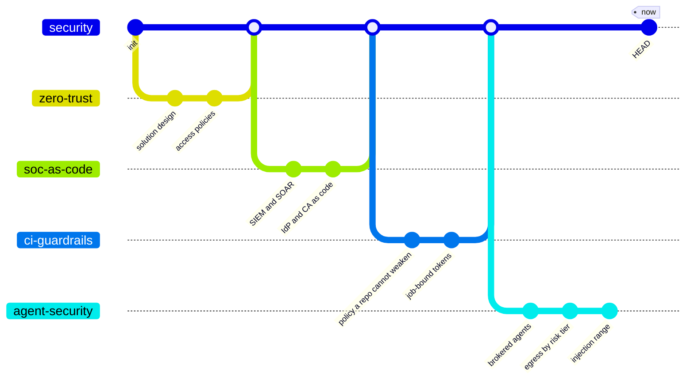

### Gérard Zapf

**Security architect and engineer.** Zero Trust, SOC infrastructure as code and AI agent security. Currently Principal Specialist Solution Engineer for Cloudflare Zero Trust at Cloudflare.

#### What I work on

- **Zero Trust architecture:** solution design for customers' Cloudflare Zero Trust deployments. Before that, the design of ZF's Zero Trust architectures.
- **SOC infrastructure as code:** SIEM, SOAR, identity provider and certificate authority, developed and operated with the ZF SOC team.
- **Guardrails in engineering workflows:** a central CI/CD policy that a repository cannot weaken. Deterministic checks block, models advise.
- **AI agent security:** brokered credentials for CI jobs and agents, hardened agent cells with egress by risk tier, a prompt-injection range for testing my own agents.

Most of this lives in private repositories on my self-hosted GitLab.

#### Public work

| | |
|---|---|
| [posture-simulator](https://github.com/Zapfmeister/posture-simulator) | Cloudflare Worker behind Access that serves custom device posture levels for Zero Trust policies |
| [maico-enocean-mqtt](https://github.com/Zapfmeister/maico-enocean-mqtt) | Reverse-engineered MAICO radio protocol (EnOcean), controls ventilation units from Home Assistant over MQTT |

Contributions to [GOAD](https://github.com/Orange-Cyberdefense/GOAD/pull/190), [authentik](https://github.com/goauthentik/authentik/pull/9541), [Cloudflare docs](https://github.com/cloudflare/cloudflare-docs/pull/33564) and the [Home Assistant Let's Encrypt add-on](https://github.com/home-assistant/apps/pull/701).

Talk: [Securing agentic harnesses: Control, visibility, and safe tool use](https://www.cloudflare.com/connect/2026/session/securing-agentic-harnesses-control-visibility-and-safe-tool-use), Cloudflare Connect 2026.

#### Toolbox

